# vox-studio

**Vox-style paper-collage explainer videos from a JSON file. 100% local. Comes with an MCP server so Claude (or any MCP client) can write, preview and render them for you.**

## Demo videos: 9 styles, 11 stories

Every demo below was rendered by this repo from the JSON story linked under it. Click a preview for the full
MP4 (with procedural sound effects). Any story can be rendered in **any** style with `--theme`.
The demo MP4s are web-compressed (720p, ~1-3 MB each) so they load fast; render a story yourself for the
full 1080p / 4K supersampled quality.

<table>
<tr>
<td align="center" width="33%"><a href="https://github.com/Hasib105/vox-studio/releases/download/demos/iron-gate.en.mp4">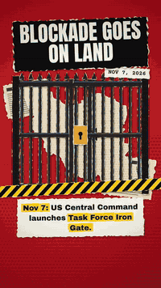</a><br><b>vox-news</b><br><sub>Iron Gate: US expands Iran blockade</sub><br><sub><a href="stories/iron-gate.en.json">story</a> · <a href="https://github.com/Hasib105/vox-studio/releases/download/demos/iron-gate.en.mp4">MP4 ▶</a></sub></td>
<td align="center" width="33%"><a href="https://github.com/Hasib105/vox-studio/releases/download/demos/coffee.scrapbook.mp4">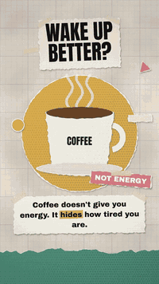</a><br><b>scrapbook</b><br><sub>Why coffee wakes you up</sub><br><sub><a href="stories/coffee.scrapbook.json">story</a> · <a href="https://github.com/Hasib105/vox-studio/releases/download/demos/coffee.scrapbook.mp4">MP4 ▶</a></sub></td>
<td align="center" width="33%"><a href="https://github.com/Hasib105/vox-studio/releases/download/demos/four-day-week.protest.mp4">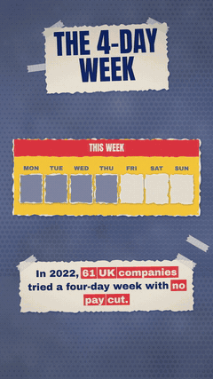</a><br><b>protest</b><br><sub>The four-day week experiment</sub><br><sub><a href="stories/four-day-week.protest.json">story</a> · <a href="https://github.com/Hasib105/vox-studio/releases/download/demos/four-day-week.protest.mp4">MP4 ▶</a></sub></td>
</tr>
<tr>
<td align="center" width="33%"><a href="https://github.com/Hasib105/vox-studio/releases/download/demos/bread.papercraft.mp4">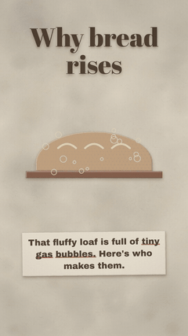</a><br><b>papercraft</b><br><sub>Why bread rises</sub><br><sub><a href="stories/bread.papercraft.json">story</a> · <a href="https://github.com/Hasib105/vox-studio/releases/download/demos/bread.papercraft.mp4">MP4 ▶</a></sub></td>
<td align="center" width="33%"><a href="https://github.com/Hasib105/vox-studio/releases/download/demos/db-cooper.noir.mp4">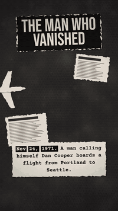</a><br><b>noir</b><br><sub>D.B. Cooper: the man who vanished</sub><br><sub><a href="stories/db-cooper.noir.json">story</a> · <a href="https://github.com/Hasib105/vox-studio/releases/download/demos/db-cooper.noir.mp4">MP4 ▶</a></sub></td>
<td align="center" width="33%"><a href="https://github.com/Hasib105/vox-studio/releases/download/demos/rubiks-cube.riso.mp4">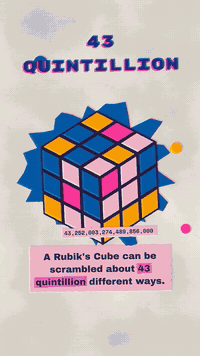</a><br><b>riso</b><br><sub>The Rubik's Cube in 30 seconds</sub><br><sub><a href="stories/rubiks-cube.riso.json">story</a> · <a href="https://github.com/Hasib105/vox-studio/releases/download/demos/rubiks-cube.riso.mp4">MP4 ▶</a></sub></td>
</tr>
<tr>
<td align="center" width="33%"><a href="https://github.com/Hasib105/vox-studio/releases/download/demos/padma-bridge.blueprint.bn.mp4">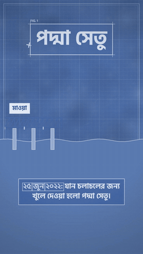</a><br><b>blueprint</b><br><sub>পদ্মা সেতু (Padma Bridge, Bangla)</sub><br><sub><a href="stories/padma-bridge.blueprint.bn.json">story</a> · <a href="https://github.com/Hasib105/vox-studio/releases/download/demos/padma-bridge.blueprint.bn.mp4">MP4 ▶</a></sub></td>
<td align="center" width="33%"><a href="https://github.com/Hasib105/vox-studio/releases/download/demos/apollo-11.retro70s.mp4">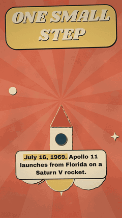</a><br><b>retro70s</b><br><sub>Apollo 11</sub><br><sub><a href="stories/apollo-11.retro70s.json">story</a> · <a href="https://github.com/Hasib105/vox-studio/releases/download/demos/apollo-11.retro70s.mp4">MP4 ▶</a></sub></td>
<td align="center" width="33%"><a href="https://github.com/Hasib105/vox-studio/releases/download/demos/iron-gate.bn.mp4">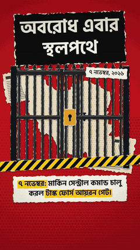</a><br><b>vox-news · Bangla</b><br><sub>আয়রন গেট (Bangla captions)</sub><br><sub><a href="stories/iron-gate.bn.json">story</a> · <a href="https://github.com/Hasib105/vox-studio/releases/download/demos/iron-gate.bn.mp4">MP4 ▶</a></sub></td>
</tr>
</table>

**16:9 landscape**

<table>
<tr>
<td align="center" width="50%"><a href="https://github.com/Hasib105/vox-studio/releases/download/demos/seasons.swiss.landscape.mp4">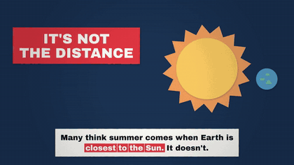</a><br><b>swiss · 16:9</b><br><sub>Why Earth has seasons</sub><br><sub><a href="stories/seasons.swiss.landscape.json">story</a> · <a href="https://github.com/Hasib105/vox-studio/releases/download/demos/seasons.swiss.landscape.mp4">MP4 ▶</a></sub></td>
<td align="center" width="50%"><a href="https://github.com/Hasib105/vox-studio/releases/download/demos/iron-gate.landscape.mp4">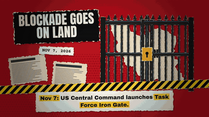</a><br><b>vox-news · 16:9</b><br><sub>Iron Gate (landscape)</sub><br><sub><a href="stories/iron-gate.landscape.json">story</a> · <a href="https://github.com/Hasib105/vox-studio/releases/download/demos/iron-gate.landscape.mp4">MP4 ▶</a></sub></td>
</tr>
</table>

**Same story, every style** (`vox gallery stories/iron-gate.en.json --scenes 1,5,8`):

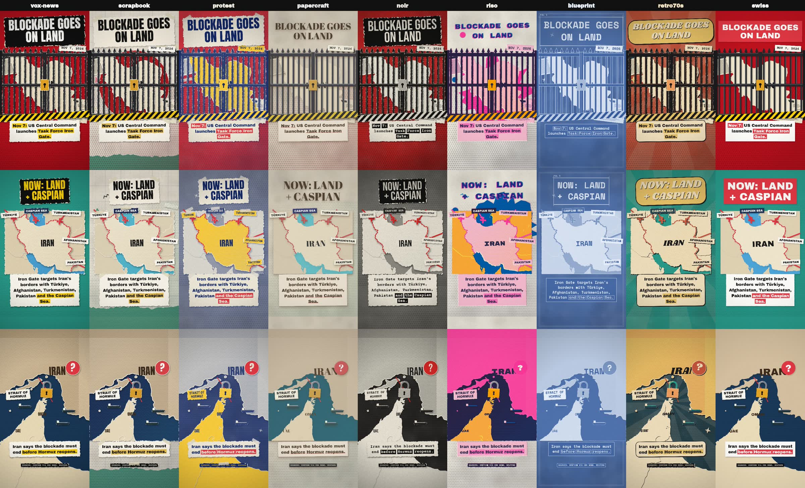

## Features

- **JSON story → MP4.** Scenes, camera moves, keyframes on any prop, enter/exit/loop animations, transitions.
- **Paper collage engine.** Every piece gets torn edges, a cream fringe, soft shadows and print grain.
- **Real geography.** Fit any country or lon/lat box, lift focus countries off the page, animate land borders,
  then pin labels, arrows, padlocks or ships to `{"geo": [lon, lat]}`.
- **45+ ready components.** Maps, labels, stamps, counters, arrows, routes, padlocks, gates, chains, ships,
  tankers, planes, trucks, barricades, crates, people, desks, starbursts, hazard tape, newspapers, photos (with
  duotone and sticker cut-outs) and more. Groups and `each` for repeating things.
- **Any language.** Captions and headlines in English, Bangla (proper conjuncts plus native digits), Hindi and
  more, with mixed scripts in one line.
- **9 visual styles.** vox-news, scrapbook, protest, papercraft, noir, riso, blueprint, retro70s, swiss. One flag
  restyles a whole story: fonts, color remap, paper treatment, backgrounds, headlines, captions, decor.
- **Super quality.** Frames are drawn at 1.5-2x and Lanczos-downscaled, encoded with x264 tuned for animation.
  9:16, 16:9, 1:1 and 4:5, up to 4K. Renders in parallel across CPU cores.
- **Sound (optional).** Whooshes, pops, thuds, stamps and paper rustle synthesized from the timeline, plus your
  own music bed.
- **MCP server.** 11 tools + a guided prompt: the AI reads the guide, writes the story, *looks at the preview
  images*, fixes problems, and renders.

## Quick start

```bash
git clone https://github.com/Hasib105/vox-studio.git
cd vox-studio
npm install          # bundles ffmpeg, fonts and map data; nothing else to install

node src/cli.js stills stories/iron-gate.en.json        # contact sheet in ~3s
node src/cli.js render stories/iron-gate.en.json        # full MP4 in output/
node src/cli.js render stories/iron-gate.bn.json --sfx  # Bangla version with sound effects
node src/cli.js render stories/coffee.scrapbook.json --theme noir   # any story, any style
node src/cli.js render stories/seasons.swiss.landscape.json --resolution 4k
node src/cli.js new my-video                            # scaffold stories/my-video.json
```

Requires Node.js 20.19+ (Windows, macOS, Linux).

> **ffmpeg not found?** Newer npm versions can block package install scripts, so `ffmpeg-static` never downloads
> its binary. Fix with `npm install-scripts approve ffmpeg-static && npm rebuild ffmpeg-static`, or install
> ffmpeg yourself, or set `FFMPEG_PATH=/path/to/ffmpeg`.

## Use it from Claude / any MCP client

The MCP server lets an AI assistant make videos end to end: research → beat map → story JSON → preview images
→ fixes → MP4.

**Claude Code** (from inside the cloned folder, `.mcp.json` is already included):
```bash
claude   # then: /mcp to confirm "vox-studio" is connected, and ask: "make a vox video about ..."
```
or add it globally:
```bash
claude mcp add vox-studio -- node /absolute/path/to/vox-studio/src/mcp/server.js
```

**Claude Desktop / Cursor / Windsurf / others** (`claude_desktop_config.json`, `.cursor/mcp.json`, ...):
```json
{
  "mcpServers": {
    "vox-studio": {
      "command": "node",
      "args": ["/absolute/path/to/vox-studio/src/mcp/server.js"],
      "env": { "VOX_WORKSPACE": "/path/where/stories/and/output/go" }
    }
  }
}
```

Tools: `vox_get_guide`, `vox_list_themes`, `vox_list_components`, `vox_list_countries`, `vox_validate_story`, `vox_preview`
(returns the contact sheet as an image), `vox_render_frame`, `vox_render_video` + `vox_render_status`
(background job; `theme`, `quality`, `resolution` options), `vox_save_story`, `vox_list_examples`, `vox_get_example`. Prompt: `vox_explainer`.

There is also a Claude Code **skill** in `.claude/skills/vox-studio` for the same workflow without MCP.

## A story in 20 lines

```json
{
  "title": "Dhaka demo", "lang": "en", "format": "9:16",
  "scenes": [
    {
      "dur": 5, "bg": "#2a9d8f", "camera": { "move": "push_in" },
      "headline": { "text": "WHERE IT\nHAPPENS", "style": "accent" },
      "caption": "Put the story on a *real map* and point at it.",
      "elements": [
        { "type": "map", "x": 540, "y": 900, "w": 880, "h": 700, "focus": ["Bangladesh"],
          "card": { "color": "#4ea8de" }, "enter": "pop" },
        { "type": "pin", "pos": { "geo": [90.41, 23.81] }, "enter": { "anim": "drop", "at": 0.8, "shake": 10 } },
        { "type": "label", "text": "DHAKA", "pos": { "geo": [90.41, 23.81], "dx": 90, "dy": -40 },
          "enter": { "anim": "pop", "at": 1.1 } }
      ]
    }
  ]
}
```

Full reference: **[docs/STORY_FORMAT.md](docs/STORY_FORMAT.md)** · Editorial rules: **[docs/DESIGN_RULES.md](docs/DESIGN_RULES.md)** ·
Every component and prop: `node src/cli.js components`.

## CLI

| command | what it does |
|---|---|
| `vox check <story>` | validate and print the timeline |
| `vox stills <story> [--scene N --times 0.1,0.5,0.9] [--full]` | contact sheet PNG for review |
| `vox frame <story> <seconds>` | one full-resolution frame |
| `vox render <story> [-o out.mp4] [--theme T] [--quality draft|standard|high|max] [--resolution 1440p|4k] [--sfx] [--music bed.mp3]` | render the MP4 |
| `vox gallery <story> [--scenes 1,5]` | the same shots in all 9 styles, side by side |
| `vox new <name> [--lang bn]` | new story from the template |
| `vox components [name]` · `vox themes` · `vox countries` | reference |

(`vox` = `node src/cli.js`, or `npm link` to get the command globally.)

## Project layout

```
src/engine/     core (easing, keyframes), paper (torn edges, halftone, grain), text (fonts, captions),
                geo (Natural Earth maps), scene (renderer, camera, transitions), audio (procedural SFX),
                render (parallel workers + ffmpeg), loader (validation)
src/components/ basic.js, objects.js, props.js, map.js   ← add your own component here
src/engine/style.js, backdrop.js, themes.js       ← the 9 visual styles
src/mcp/        MCP server
stories/        11 example stories (one per style, EN + Bangla, 9:16 + 16:9) + template
docs/           story format, design rules, media
```

Adding a component is ~20 lines: export `{ doc, props, draw(ctx, p, S) }` from a file in `src/components/`
and spread it into `src/components/index.js`.

## Credits and licenses

- Code: MIT (see [LICENSE](LICENSE)).
- Fonts in `assets/fonts`: Anton, Archivo Black, Courier Prime, Hind Siliguri, Abril Fatface, Caveat Brush,
  Bebas Neue, Shrikhand, Rubik Mono One, Space Mono, Galada, Tiro Bangla, all under the
  [SIL Open Font License 1.1](assets/fonts/OFL.txt) (Google Fonts).
- Map data: [Natural Earth](https://www.naturalearthdata.com/) (public domain) via
  [world-atlas](https://github.com/topojson/world-atlas) (ISC).
- Rendering: [@napi-rs/canvas](https://github.com/Brooooooklyn/canvas) (Skia), [ffmpeg-static](https://github.com/eugeneware/ffmpeg-static), [d3-geo](https://github.com/d3/d3-geo).
- "Vox-style" describes the editorial paper-collage look; this project is not affiliated with Vox Media.
- Demo stories are based on public sources listed in each story file (`"sources"`). The Iron Gate story uses
  reporting from Nov 7, 2026.
