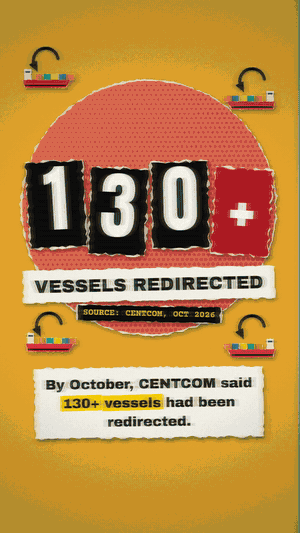
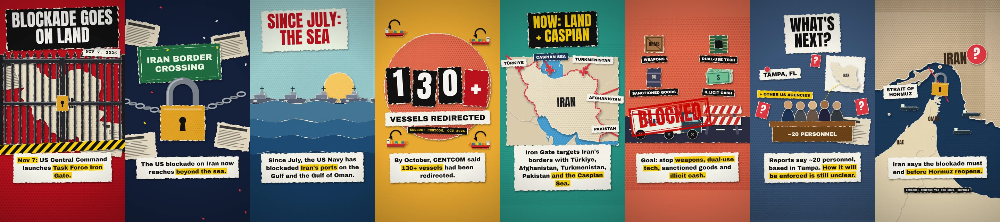

# vox-studio

**Vox-style paper-collage explainer videos from a JSON file. 100% local. Comes with an MCP server so Claude (or any MCP client) can write, preview and render them for you.**

<p align="center">
  
  &nbsp;&nbsp;
  
</p>




Torn paper, halftone dots, drop shadows, stop-motion boil, punchy headlines, word-by-word captions, **real maps**
from Natural Earth, paper-tear and whip transitions, and optional procedural paper foley. No cloud APIs, no
credits, no GPU: just Node.js.

## Features

- **JSON story → MP4.** Scenes, camera moves, keyframes on any prop, enter/exit/loop animations, transitions.
- **Paper collage engine.** Every piece gets torn edges, a cream fringe, soft shadows and print grain.
- **Real geography.** Fit any country or lon/lat box, lift focus countries off the page, animate land borders,
  then pin labels, arrows, padlocks or ships to `{"geo": [lon, lat]}`.
- **30+ ready components.** Maps, labels, stamps, counters, arrows, routes, padlocks, gates, chains, ships,
  tankers, planes, trucks, barricades, crates, people, desks, starbursts, hazard tape, newspapers, photos (with
  duotone and sticker cut-outs) and more. Groups and `each` for repeating things.
- **Any language.** Captions and headlines in English, Bangla (proper conjuncts plus native digits), Hindi and
  more, with mixed scripts in one line.
- **Fast.** Renders in parallel across CPU cores (a 40s 1080x1920 video takes ~70s on a laptop).
- **Sound (optional).** Whooshes, pops, thuds, stamps and paper rustle synthesized from the timeline, plus your
  own music bed.
- **MCP server.** 11 tools + a guided prompt: the AI reads the guide, writes the story, *looks at the preview
  images*, fixes problems, and renders.

## Quick start

```bash
git clone https://github.com/Hasib105/vox-studio.git
cd vox-studio
npm install          # bundles ffmpeg, fonts and map data; nothing else to install

node src/cli.js stills stories/iron-gate.en.json        # contact sheet in ~3s
node src/cli.js render stories/iron-gate.en.json        # full MP4 in output/
node src/cli.js render stories/iron-gate.bn.json --sfx  # Bangla version with sound effects
node src/cli.js new my-video                            # scaffold stories/my-video.json
```

Requires Node.js 20.19+ (Windows, macOS, Linux).

> **ffmpeg not found?** Newer npm versions can block package install scripts, so `ffmpeg-static` never downloads
> its binary. Fix with `npm install-scripts approve ffmpeg-static && npm rebuild ffmpeg-static`, or install
> ffmpeg yourself, or set `FFMPEG_PATH=/path/to/ffmpeg`.

## Use it from Claude / any MCP client

The MCP server lets an AI assistant make videos end to end: research → beat map → story JSON → preview images
→ fixes → MP4.

**Claude Code** (from inside the cloned folder, `.mcp.json` is already included):
```bash
claude   # then: /mcp to confirm "vox-studio" is connected, and ask: "make a vox video about ..."
```
or add it globally:
```bash
claude mcp add vox-studio -- node /absolute/path/to/vox-studio/src/mcp/server.js
```

**Claude Desktop / Cursor / Windsurf / others** (`claude_desktop_config.json`, `.cursor/mcp.json`, ...):
```json
{
  "mcpServers": {
    "vox-studio": {
      "command": "node",
      "args": ["/absolute/path/to/vox-studio/src/mcp/server.js"],
      "env": { "VOX_WORKSPACE": "/path/where/stories/and/output/go" }
    }
  }
}
```

Tools: `vox_get_guide`, `vox_list_components`, `vox_list_countries`, `vox_validate_story`, `vox_preview`
(returns the contact sheet as an image), `vox_render_frame`, `vox_render_video` + `vox_render_status`
(background job), `vox_save_story`, `vox_list_examples`, `vox_get_example`. Prompt: `vox_explainer`.

There is also a Claude Code **skill** in `.claude/skills/vox-studio` for the same workflow without MCP.

## A story in 20 lines

```json
{
  "title": "Dhaka demo", "lang": "en", "format": "9:16",
  "scenes": [
    {
      "dur": 5, "bg": "#2a9d8f", "camera": { "move": "push_in" },
      "headline": { "text": "WHERE IT\nHAPPENS", "style": "accent" },
      "caption": "Put the story on a *real map* and point at it.",
      "elements": [
        { "type": "map", "x": 540, "y": 900, "w": 880, "h": 700, "focus": ["Bangladesh"],
          "card": { "color": "#4ea8de" }, "enter": "pop" },
        { "type": "pin", "pos": { "geo": [90.41, 23.81] }, "enter": { "anim": "drop", "at": 0.8, "shake": 10 } },
        { "type": "label", "text": "DHAKA", "pos": { "geo": [90.41, 23.81], "dx": 90, "dy": -40 },
          "enter": { "anim": "pop", "at": 1.1 } }
      ]
    }
  ]
}
```

Full reference: **[docs/STORY_FORMAT.md](docs/STORY_FORMAT.md)** · Editorial rules: **[docs/DESIGN_RULES.md](docs/DESIGN_RULES.md)** ·
Every component and prop: `node src/cli.js components`.

## CLI

| command | what it does |
|---|---|
| `vox check <story>` | validate and print the timeline |
| `vox stills <story> [--scene N --times 0.1,0.5,0.9] [--full]` | contact sheet PNG for review |
| `vox frame <story> <seconds>` | one full-resolution frame |
| `vox render <story> [-o out.mp4] [--scale 0.5] [--sfx] [--music bed.mp3] [--workers N]` | render the MP4 |
| `vox new <name> [--lang bn]` | new story from the template |
| `vox components [name]` · `vox themes` · `vox countries` | reference |

(`vox` = `node src/cli.js`, or `npm link` to get the command globally.)

## Project layout

```
src/engine/     core (easing, keyframes), paper (torn edges, halftone, grain), text (fonts, captions),
                geo (Natural Earth maps), scene (renderer, camera, transitions), audio (procedural SFX),
                render (parallel workers + ffmpeg), loader (validation)
src/components/ basic.js, objects.js, map.js   ← add your own component here
src/mcp/        MCP server
stories/        example stories (EN + Bangla news explainer, template)
docs/           story format, design rules, media
```

Adding a component is ~20 lines: export `{ doc, props, draw(ctx, p, S) }` from a file in `src/components/`
and spread it into `src/components/index.js`.

## Credits and licenses

- Code: MIT (see [LICENSE](LICENSE)).
- Fonts in `assets/fonts`: Anton, Archivo Black, Courier Prime, Hind Siliguri, all under the
  [SIL Open Font License 1.1](assets/fonts/OFL.txt) (Google Fonts).
- Map data: [Natural Earth](https://www.naturalearthdata.com/) (public domain) via
  [world-atlas](https://github.com/topojson/world-atlas) (ISC).
- Rendering: [@napi-rs/canvas](https://github.com/Brooooooklyn/canvas) (Skia), [ffmpeg-static](https://github.com/eugeneware/ffmpeg-static), [d3-geo](https://github.com/d3/d3-geo).
- "Vox-style" describes the editorial paper-collage look; this project is not affiliated with Vox Media.
- The included Iron Gate story is a demo based on public reporting from Nov 7, 2026 (sources in the story file).
